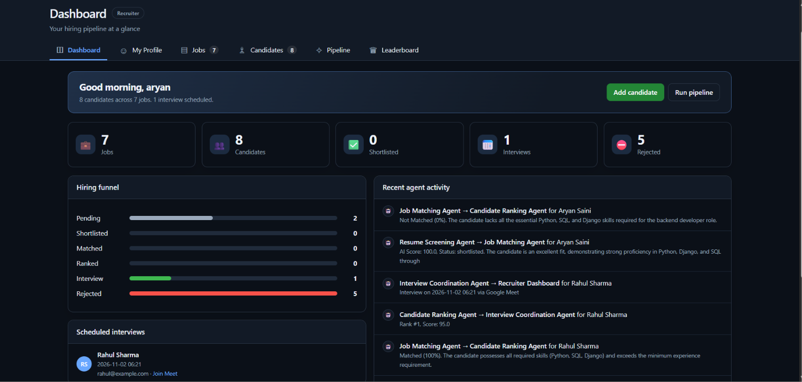
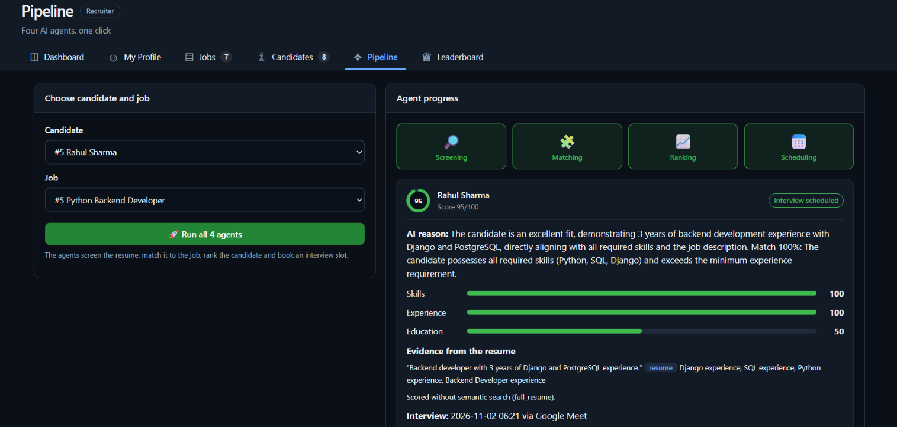
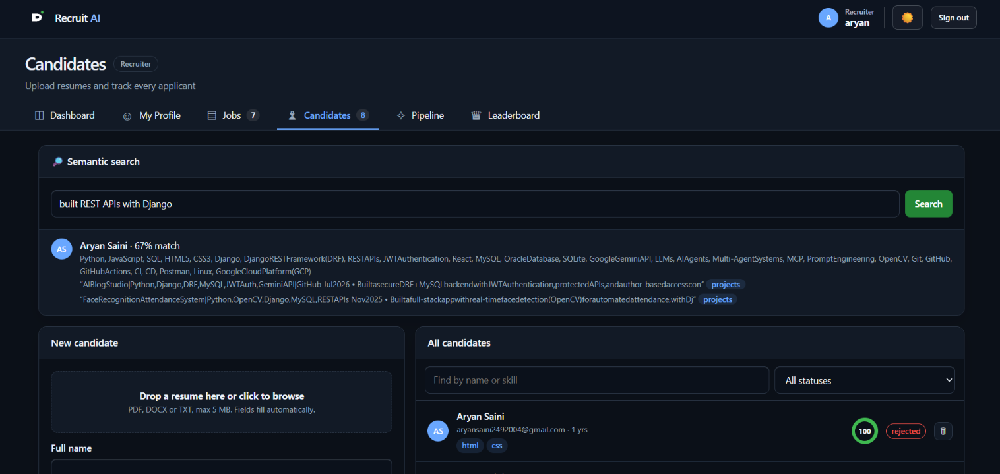
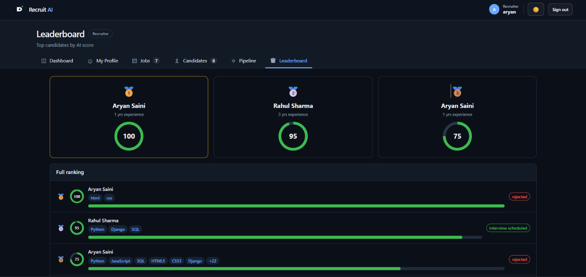
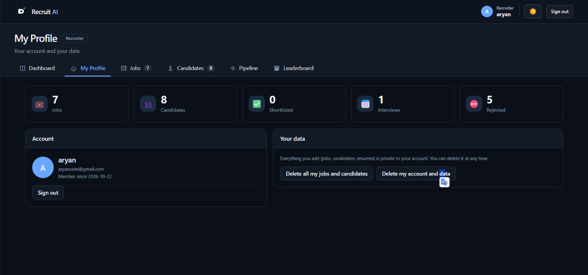
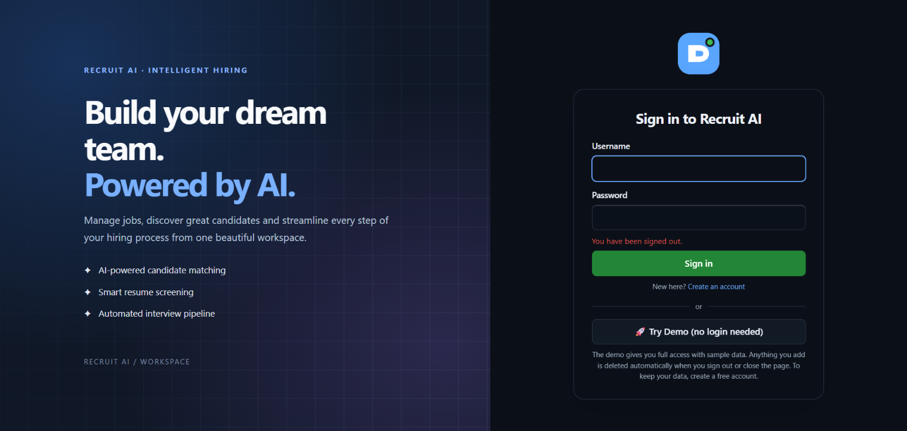
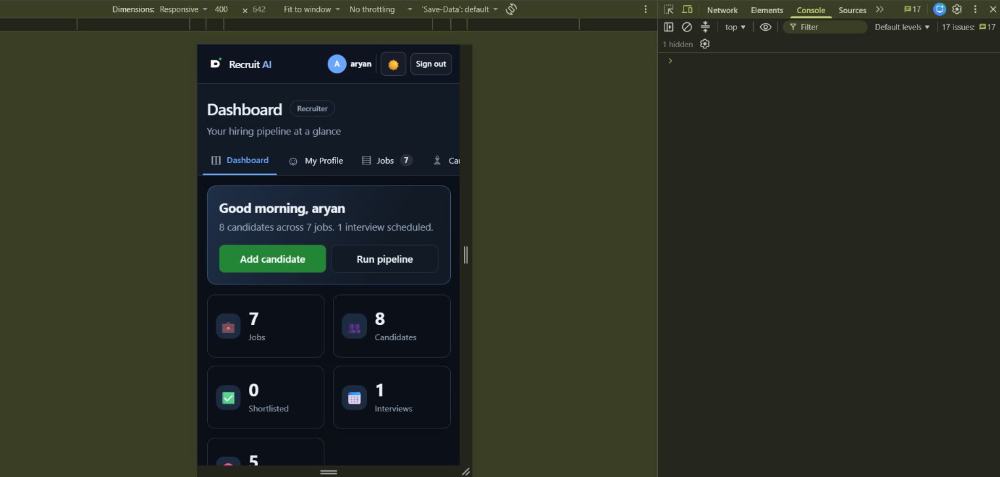
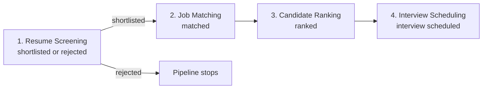
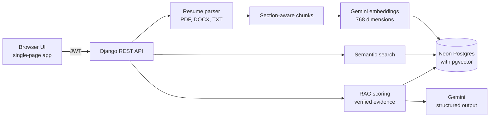

# Recruit AI

An AI-assisted recruitment workspace. Recruiters add jobs, upload resumes, search candidates by meaning, and run a screening pipeline that scores every candidate against a job using **evidence quoted from the resume itself**.

**Live demo:** [recruitment-ai-e88m.onrender.com](https://recruitment-ai-e88m.onrender.com/) &nbsp;·&nbsp; use **Try Demo** for a temporary workspace with sample data, no sign-up needed.

> The demo runs on free hosting. After a period of inactivity the first request can take up to a minute while the service wakes up.


<!-- Add this badge only after the MCP servers are built (roadmap):

-->

---

## Contents

- [Features](#features)
- [Screenshots](#screenshots)
- [Multi-agent pipeline](#multi-agent-pipeline)
- [How scoring works](#how-scoring-works)
- [Architecture](#architecture)
- [Tech stack](#tech-stack)
- [Getting started](#getting-started)
- [Configuration](#configuration)
- [API overview](#api-overview)
- [Testing](#testing)
- [Deployment](#deployment)
- [Project structure](#project-structure)
- [Known limitations](#known-limitations)
- [Roadmap](#roadmap)

---

## Features

**Candidate and job management**
- Create jobs and candidates, and delete them at any time.
- Upload resumes as **PDF, DOCX or TXT** (up to 5 MB). Text, sections, email, phone and skills are extracted automatically and pre-fill the form.

**Semantic search**
- Resumes are split into section-aware chunks and embedded with `gemini-embedding-001` (768 dimensions, normalised).
- Vectors are stored in Postgres with **pgvector** and an HNSW index. Search by meaning, for example "who has built REST APIs with Django?", and see the matching resume passages.
- The header / contact section of a resume is excluded from the chunks used for embedding and retrieval.

**Evidence-based screening**
- A four-stage pipeline: screening, job matching, ranking and interview scheduling. Candidates that fail screening are rejected and do not continue to scheduling.
- Every score comes with a breakdown (skills, experience, education) and **verified quotes from the resume**.
- Every agent hand-off is written to an activity log that is shown on the dashboard.

**Accounts and privacy**
- JWT authentication (login, refresh) with username, email and password sign-up.
- **Per-recruiter data isolation.** Each recruiter only ever sees their own jobs, candidates and resumes; requests for someone else's records return 404.
- A **My Profile** page with account details, personal counts, "delete all my jobs and candidates", and full account deletion.
- Optional email-OTP verification at sign-up (switched off by default, see [Configuration](#configuration)).

**Demo mode**
- **Try Demo** creates a private, temporary workspace pre-loaded with fictional data and full access. It is deleted when the visitor signs out or closes the page, and the server also removes stale demo workspaces after two hours.

**Security and reliability**
- Secrets and settings come from environment variables; CORS is restricted to configured origins.
- Rate limits on login, sign-up, demo, pipeline runs and search (per user, per IP and per day).
- All user content is HTML-escaped in the UI. Upload parsing is guarded against oversized or malicious archives.
- No silent fallbacks: if the AI model is unavailable (for example the free quota is used up), the result is produced by a rule-based scorer and **clearly flagged** in the UI and the database (`fallback_used`).
- A `/healthz` endpoint for uptime monitoring.

---

## Screenshots

**Dashboard.** Hiring funnel, scheduled interviews and recent agent activity.



**Pipeline run.** Four agents screen, match, rank and schedule a candidate. The result shows the score breakdown and the quotes taken from the resume.



**Semantic search.** Find candidates by meaning and see the matching resume passages.



**Leaderboard and profile.**





**Sign-in and mobile.**





---

## Multi-agent pipeline

Instead of one large prompt doing everything, the work is split across **four specialised agents**. Each agent has a single responsibility, reads and updates the same application record (one candidate applying to one job), and hands off to the next. Every hand-off is written to an activity log (`AgentLog`) that is shown on the dashboard.



| # | Agent | Responsibility | Technique |
|---|---|---|---|
| 1 | **Resume Screening** | Scores the resume against the job, using evidence from the resume | Retrieval over pgvector chunks, Gemini structured output, quote verification, fixed-weight score |
| 2 | **Job Matching** | Checks how well the candidate fits the job's requirements | AI judgement with a rule-based fallback |
| 3 | **Candidate Ranking** | Orders candidates by their score | Score ordering |
| 4 | **Interview Scheduling** | Proposes an interview time slot and records it | Slot selection |

**Design principles**

- **Single responsibility.** Each agent can be tested, replaced or improved on its own.
- **Shared state.** The agents communicate through one record per candidate and job: score, status, reason, score breakdown, resume evidence, whether a fallback was used, and the interview time.
- **Language model for judgement, code for decisions.** The model reads and judges the resume; the final score and the status changes are computed by deterministic code.
- **Auditable.** Every hand-off is logged, and every result that did not come from the AI model is flagged.
- **Fail-safe.** If the model is unavailable, a rule-based fallback keeps the pipeline running instead of failing silently or inventing results.

**Current state.** The four agents run in sequence as plain Python functions, with the AI-powered parts of agents 1 and 2 calling Gemini. Moving the orchestration to Google ADK (`LlmAgent`s coordinated by a `SequentialAgent`) is on the [roadmap](#roadmap).

---

## How scoring works

1. **Retrieve.** For the candidate being screened, the top semantically relevant resume chunks (plus the education chunk) are retrieved. If embeddings are unavailable, the pipeline falls back to keyword retrieval or the full resume, and records which mode was used.
2. **Ask the model.** Gemini is called with structured output (Pydantic schema). The resume is treated as untrusted data, so instructions hidden inside a resume are not followed.
3. **Verify.** Every evidence quote returned by the model is checked against the resume text. Quotes that are not actually in the resume are dropped.
4. **Combine deterministically.** The overall score is computed in code, not by the model:

   | Component | Weight | Source |
   |---|---|---|
   | Skills | 0.6 | model score, based on verified evidence |
   | Experience | 0.3 | years of experience compared with the job's minimum |
   | Education | 0.1 | model score |

---

## Architecture



The four pipeline agents are described in [Multi-agent pipeline](#multi-agent-pipeline).

---

## Tech stack

| Area | Technology |
|---|---|
| Backend | Django 5.2, Django REST Framework, SimpleJWT, django-cors-headers |
| Database | PostgreSQL on Neon with `pgvector` (SQLite as a local fallback) |
| AI | Google Gemini via `google-genai` (default model `gemini-2.5-flash`), `gemini-embedding-001` embeddings |
| Agents | Google ADK foundation (`google-adk`): an LLM agent and retrieval / scoring tools, see [Roadmap](#roadmap) |
| Parsing | `pdfplumber`, `python-docx` |
| Frontend | Single-page UI in `templates/index.html` (vanilla JavaScript, light and dark themes, responsive) |
| Tooling | Docker, GitHub Actions (tests), Render, UptimeRobot |

---

## Getting started

Requirements: Python 3.11 or newer (needed by `google-adk`) and, optionally, a free [Neon](https://neon.tech) Postgres database and a [Gemini API key](https://aistudio.google.com/apikey).

```bash
git clone https://github.com/aryaansaini/recruitment-ai.git
cd recruitment-ai

python -m venv venv
venv\Scripts\activate          # Windows
# source venv/bin/activate     # macOS / Linux

pip install -r requirements.txt
cp .env.example .env           # Windows: copy .env.example .env
```

Edit `.env` (see [Configuration](#configuration)), then:

```bash
python manage.py migrate
python manage.py seed_demo     # optional: sample data for the Try Demo workspace
python manage.py runserver
```

Open http://127.0.0.1:8000/.

If `DATABASE_URL` is empty the app uses a local SQLite file. Semantic search and the pgvector index need Postgres; on SQLite, similarity is computed in Python instead.

Useful management commands:

| Command | Purpose |
|---|---|
| `check_db` | Show which database is in use and whether pgvector is available |
| `embed_chunks` | Backfill embeddings for resume chunks that have none |
| `rag_demo` | Run the retrieval and scoring flow from the command line |
| `adk_hello` | Smoke-test the Google ADK setup |
| `seed_demo` | Create the sample workspace used by Try Demo |

---

## Configuration

Set these in `.env` locally, or in your host's environment settings in production.

| Variable | Description |
|---|---|
| `SECRET_KEY` | Django secret key (required in production) |
| `DEBUG` | `True` or `False` |
| `ALLOWED_HOSTS` | Comma-separated hostnames |
| `CORS_ALLOWED_ORIGINS` | Comma-separated allowed origins |
| `DATABASE_URL` | Postgres connection string (Neon). Empty means SQLite |
| `TEST_DATABASE_URL` | Optional database used only by tests that need Postgres |
| `GEMINI_API_KEY` | Google Gemini API key |
| `GEMINI_MODEL` | Defaults to `gemini-2.5-flash` |
| `EMBEDDING_MODEL` | Defaults to `gemini-embedding-001` |
| `EMAIL_OTP_REQUIRED` | `True` turns on email-OTP verification at sign-up. Off by default |
| `EMAIL_BACKEND`, `DEFAULT_FROM_EMAIL` | Email delivery. By default emails print to the console |
| `BREVO_API_KEY` | Only if you use the included Brevo HTTPS email backend |

Never commit `.env`. A template is provided in `.env.example`.

---

## API overview

All endpoints except those under "Public" require a JWT (`Authorization: Bearer <token>`).

**Public**

| Method | Path | Description |
|---|---|---|
| GET | `/healthz` | Health check |
| POST | `/api/auth/signup/` | Create an account |
| POST | `/api/auth/login/` | Obtain access and refresh tokens |
| POST | `/api/auth/refresh/` | Refresh the access token |
| POST | `/api/auth/demo/` | Start a temporary demo workspace |
| POST | `/api/auth/verify-otp/`, `/api/auth/resend-otp/` | Email-OTP verification (when enabled) |
| GET | `/api/auth/config/` | Public sign-up settings for the login screen |

**Authenticated**

| Method | Path | Description |
|---|---|---|
| GET, DELETE | `/api/auth/me/` | Current user; delete the account (password required) |
| GET | `/api/auth/profile/` | Profile and counts |
| POST | `/api/auth/clear-data/` | Delete all of your jobs and candidates |
| POST | `/api/auth/demo/end/` | End and delete a demo workspace |
| GET, POST | `/api/jobs/`, `/api/add-job/` | List and create jobs |
| DELETE | `/api/jobs/<id>/` | Delete a job |
| GET, POST | `/api/candidates/`, `/api/add-candidate/` | List and create candidates |
| DELETE | `/api/candidates/<id>/` | Delete a candidate |
| POST | `/api/parse-resume/` | Parse an uploaded PDF, DOCX or TXT resume |
| POST | `/api/run-pipeline/` | Run the pipeline for one candidate and one job |
| GET | `/api/search/?q=` | Semantic resume search |
| GET | `/api/logs/` | Agent activity log |

---

## Testing

```bash
python manage.py test
```

The suite (198 tests at the time of writing) covers authentication, per-recruiter isolation, demo workspaces, rate limits, resume parsing, embeddings, semantic search, RAG scoring and the pipeline. LLM-dependent logic is tested with stubs and mocks. Tests always run against SQLite and never touch your Neon database. GitHub Actions runs the suite on every push.

---

## Deployment

The live demo runs on:

- **Render**: web service for the Django app
- **Neon**: serverless Postgres with pgvector
- **UptimeRobot**: periodic pings of `/healthz`

Set the variables from [Configuration](#configuration) in the Render dashboard and run `python manage.py migrate` on each deploy. A `Dockerfile` is included for containerised runs.

---

## Project structure

```
manage.py
requirements.txt
Dockerfile
.env.example
recruitment_project/        settings.py, urls.py
templates/index.html        single-page UI
api/
  models.py                 Candidate, Job, Application, AgentLog, ResumeChunk,
                            RecruiterProfile, EmailOTP
  views.py, auth_views.py   REST endpoints
  urls.py, serializers.py, throttles.py, admin.py, health.py
  agents.py                 four-stage pipeline
  llm.py                    Gemini structured-output client
  resume_parser.py          PDF / DOCX / TXT parsing and chunking
  embeddings.py, search.py  embeddings and semantic search
  rag.py                    retrieval, prompt building, evidence verification, scoring
  services.py               chunk rebuilding and shared helpers
  adk_utils.py, adk_agents.py, adk_tools.py    Google ADK foundation
  brevo_backend.py          optional email backend over HTTPS
  management/commands/      check_db, embed_chunks, rag_demo, adk_hello, seed_demo
  migrations/
  tests*.py
```

---

## Known limitations

These are documented so the project's current scope is clear:

- The four pipeline stages are currently plain Python functions. The Google ADK layer (an LLM agent plus retrieval and scoring tools) is in place but is **not yet** the orchestrator of the pipeline.
- The ranking stage currently ranks the single candidate being processed, so there is not yet a true per-job leaderboard.
- Interview scheduling proposes a time slot. It does **not** integrate with a real calendar and does not send invitations.
- There are no MCP servers and no agent-to-agent protocol in this repository yet.
- The AI model runs on a free API tier. When its quota is exhausted, the rule-based fallback is used and flagged.
- Email addresses are not verified unless `EMAIL_OTP_REQUIRED` is enabled.

---

## Roadmap

Change `[ ]` to `[x]` as items are completed.

**Agents**
- [ ] Four Google ADK `LlmAgent`s orchestrated by a `SequentialAgent`, using the retrieval and scoring tools
- [ ] Ranking across all candidates of a job, with a job-wise leaderboard
- [ ] Agent activity log written from ADK callbacks
- [ ] Tests for the agent pipeline with a stub LLM

**Integrations**
- [ ] MCP servers (official MCP SDK) for ATS, resume parsing and calendar
- [ ] Agents connected to the MCP servers through ADK's `McpToolset`
- [ ] Interview scheduling with slot logic and `.ics` invitations

**Interface**
- [ ] Candidate detail page
- [ ] Kanban board for application status
- [ ] Agent timeline view
- [ ] Job-wise leaderboard page

**Done**
- [x] JWT authentication and per-recruiter data isolation
- [x] Resume parsing, section-aware chunking and Gemini embeddings
- [x] pgvector semantic search
- [x] RAG scoring with verified evidence and deterministic weights
- [x] Demo workspaces, My Profile, optional email-OTP verification
- [x] Dockerfile, GitHub Actions tests, seed command, Render + Neon + UptimeRobot deployment

---

Built by [@aryaansaini](https://github.com/aryaansaini).
