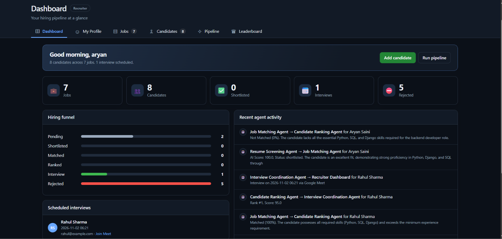
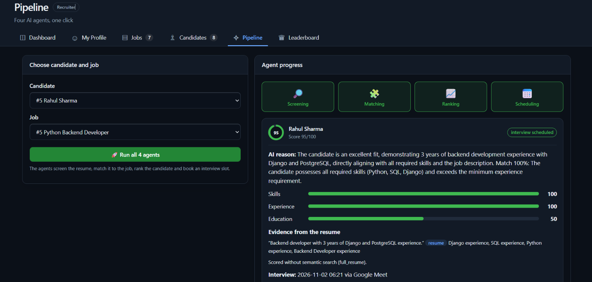
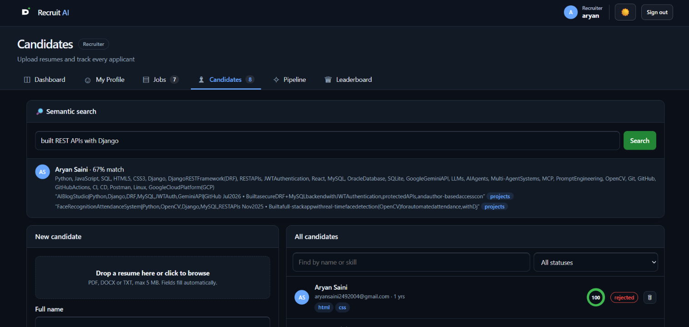
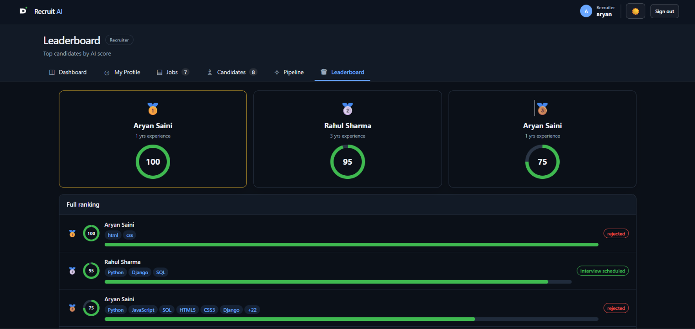
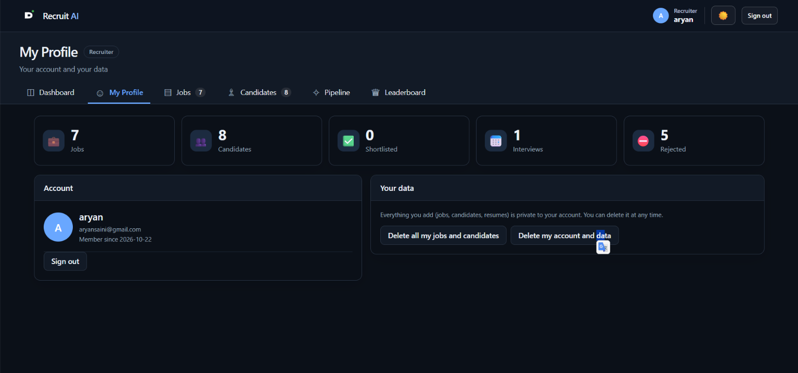
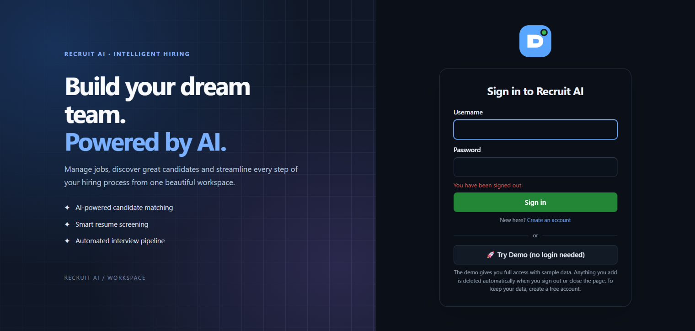
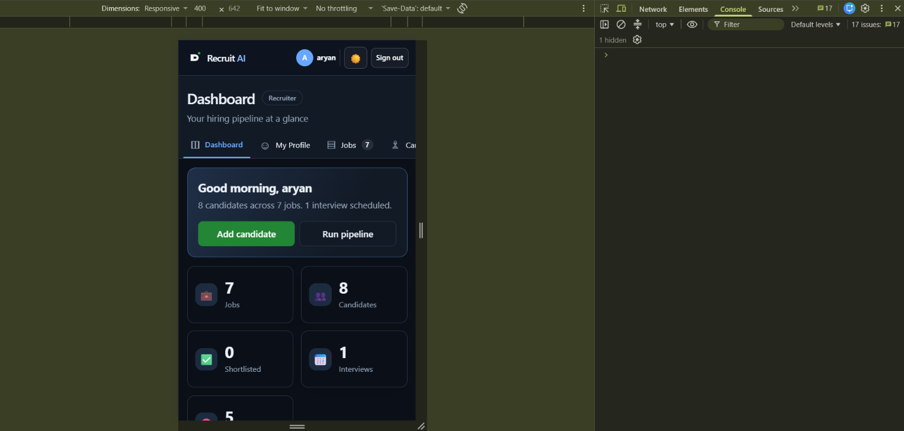
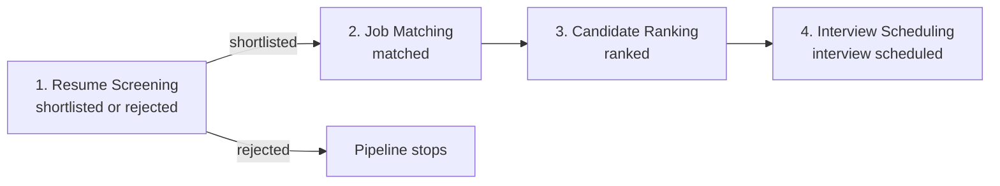
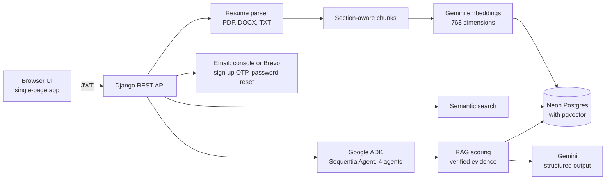

# Recruit AI

An AI-assisted recruitment workspace. Recruiters add jobs, upload resumes, search candidates by meaning, check which of their jobs a CV fits, and run a four-agent screening pipeline (orchestrated with **Google ADK**) that scores every candidate against a job using **evidence quoted from the resume itself**.

**Live demo:** [recruitment-ai-e88m.onrender.com](https://recruitment-ai-e88m.onrender.com/) &nbsp;·&nbsp; use **Try Demo** for a temporary workspace with sample data, no sign-up needed.

> The demo runs on free hosting. After a period of inactivity the first request can take up to a minute while the service wakes up.


<!-- Add this badge only after real MCP servers are built (see Roadmap):

-->

---

## Contents

- [Features](#features)
- [Screenshots](#screenshots)
- [Multi-agent pipeline](#multi-agent-pipeline)
- [How scoring works](#how-scoring-works)
- [CV Match](#cv-match)
- [Authentication, email OTP and password reset](#authentication-email-otp-and-password-reset)
- [Architecture](#architecture)
- [Tech stack](#tech-stack)
- [Getting started](#getting-started)
- [Configuration](#configuration)
- [API overview](#api-overview)
- [Testing](#testing)
- [Deployment](#deployment)
- [Project structure](#project-structure)
- [Known limitations](#known-limitations)
- [Roadmap](#roadmap)

---

## Features

**Candidate and job management**
- Create jobs and candidates, and delete them at any time.
- Upload resumes as **PDF, DOCX or TXT** (up to 5 MB). Text, sections, email, phone and skills are extracted automatically and pre-fill the form.

**Semantic search**
- Resumes are split into section-aware chunks and embedded with `gemini-embedding-001` (768 dimensions, normalised).
- Vectors are stored in Postgres with **pgvector** and an HNSW index. Search by meaning, for example "who has built REST APIs with Django?", and see the matching resume passages.
- The header / contact section of a resume is excluded from the chunks used for embedding and retrieval.

**Workspace views**
- **Job-wise leaderboard.** Pick a job and see everyone who applied, ranked (ties share a rank), with a podium for the top three. "All jobs" keeps the overall score ranking.
- **Candidate detail page.** Click any candidate name to see the profile, the full resume text, every application with its score breakdown, verified resume quotes and AI reason, and that candidate's own agent timeline.
- **Kanban board.** Applications grouped by stage (pending, shortlisted, matched, ranked, interview, rejected), filterable by job. Move a card by drag and drop or with the menu on the card (works on touch screens). Moves are saved and written to the activity log as "Recruiter".
- **Agent timeline.** A vertical timeline of every hand-off between the agents, newest first, filterable by candidate.

**CV Match**
- Upload a CV and see which of *your* jobs it is eligible for, with matched and missing skills per job. Nothing is saved. See [CV Match](#cv-match).

**Evidence-based screening**
- A four-stage pipeline run by a **Google ADK `SequentialAgent`**: screening, job matching, ranking and interview scheduling. Candidates that fail screening or matching are rejected and do not continue to scheduling.
- **Per-job ranking.** Candidates are ranked only against others who applied to the same job (ties share a rank). `GET /api/jobs/<id>/leaderboard/` returns the full ranked list for a job.
- Every score comes with a breakdown (skills, experience, education) and **verified quotes from the resume**.
- Every agent hand-off is written to an activity log that is shown on the dashboard.

**Accounts and privacy**
- JWT authentication (login, refresh). Sign in with **username or email**.
- Sign-up with username, email and password, with optional **email-OTP verification**.
- **Forgot password:** a 6-digit reset code is emailed and the new password is set with it. See [Authentication](#authentication-email-otp-and-password-reset).
- **Per-recruiter data isolation.** Each recruiter only ever sees their own jobs, candidates and resumes; requests for someone else's records return 404.
- A **My Profile** page with account details, personal counts, "delete all my jobs and candidates", and full account deletion.

**Demo mode**
- **Try Demo** creates a private, temporary workspace pre-loaded with fictional data and full access. It is deleted when the visitor signs out or closes the page, and the server also removes stale demo workspaces after two hours.

**Security and reliability**
- Secrets and settings come from environment variables; CORS is restricted to configured origins.
- Rate limits on login, sign-up, demo, OTP, forgot-password, pipeline runs and search (per user, per IP and per day).
- All user content is HTML-escaped in the UI. Upload parsing is guarded against oversized or malicious archives.
- No silent fallbacks: if the AI model is unavailable (for example the free quota is used up), the result is produced by a rule-based scorer and **clearly flagged** in the UI and the database (`fallback_used`).
- A `/healthz` endpoint for uptime monitoring.

---

## Screenshots

**Dashboard.** Hiring funnel, scheduled interviews and recent agent activity.



**Pipeline run.** Four agents screen, match, rank and schedule a candidate. The result shows the score breakdown and the quotes taken from the resume.



**Semantic search.** Find candidates by meaning and see the matching resume passages.



**Leaderboard and profile.**





**Sign-in and mobile.**





---

## Multi-agent pipeline

Instead of one large prompt doing everything, the work is split across **four specialised agents**. Each agent has a single responsibility, reads and updates the same application record (one candidate applying to one job), and hands off to the next. Every hand-off is written to an activity log (`AgentLog`) that is shown on the dashboard.



| # | Agent | Responsibility | Technique |
|---|---|---|---|
| 1 | **Resume Screening** | Scores the resume against the job, using evidence from the resume | Retrieval over pgvector chunks, Gemini structured output, quote verification, fixed-weight score |
| 2 | **Job Matching** | Checks how well the candidate fits the job's requirements | AI judgement with a rule-based fallback |
| 3 | **Candidate Ranking** | Ranks the candidate against everyone already qualified for the same job | Competition ranking (1, 2, 2, 4) over stored applications |
| 4 | **Interview Scheduling** | Proposes an interview time slot and records it | Slot selection |

**Design principles**

- **Single responsibility.** Each agent can be tested, replaced or improved on its own.
- **Shared state.** The agents communicate through one record per candidate and job: score, status, reason, score breakdown, resume evidence, whether a fallback was used, and the interview time.
- **Language model for judgement, code for decisions.** The model reads and judges the resume; the final score and the status changes are computed by deterministic code.
- **Auditable.** Every hand-off is logged, and every result that did not come from the AI model is flagged.
- **Fail-safe.** If the model is unavailable, a rule-based fallback keeps the pipeline running instead of failing silently or inventing results.

**How ADK is used.** The four agents are ADK `BaseAgent` subclasses (`api/adk_pipeline.py`) coordinated by a `SequentialAgent`. Each one runs the project's own tested logic from `api/agents.py` and writes what it decided to the ADK session state. Agents 3 and 4 skip themselves for candidates who did not qualify. They are custom agents rather than `LlmAgent`s on purpose: agents 1 and 2 keep using the project's own Gemini client, which gives verified resume quotes, fixed score weights and a clearly flagged rule-based fallback. Set `PIPELINE_USE_ADK=False` to run the same four steps as plain Python functions.

`api/adk_agents.py` also contains a small `LlmAgent` (a skill extractor with structured output), and `api/adk_tools.py` exposes retrieval and scoring as ADK tools. These are used by the management commands and tests; the pipeline itself uses the custom agents above.

---

## How scoring works

1. **Retrieve.** For the candidate being screened, the top semantically relevant resume chunks (plus the education chunk) are retrieved. If embeddings are unavailable, the pipeline falls back to keyword retrieval or the full resume, and records which mode was used.
2. **Ask the model.** Gemini is called with structured output (Pydantic schema). The resume is treated as untrusted data, so instructions hidden inside a resume are not followed.
3. **Verify.** Every evidence quote returned by the model is checked against the resume text. Quotes that are not actually in the resume are dropped.
4. **Combine deterministically.** The overall score is computed in code, not by the model:

   | Component | Weight | Source |
   |---|---|---|
   | Skills | 0.6 | model score, based on verified evidence |
   | Experience | 0.3 | years of experience compared with the job's minimum |
   | Education | 0.1 | model score |

---

## CV Match

`POST /api/match-cv/` answers "which of my jobs is this CV eligible for?". The UI has a **CV Match** tab where you upload a CV (PDF, DOCX or TXT); it is parsed with `/api/parse-resume/` and then matched against the recruiter's own jobs. Nothing is saved.

For every job the result contains a score, a verdict, the matched and missing skills and whether the experience requirement is met. Matching is deterministic (no AI call, no quota used):

- A required skill counts as matched if it is in the CV's skill list or appears as a **whole word** in the resume text (so `java` does not match `javascript`, and `c` does not match `c++`).
- **eligible**: at least 50% of the required skills and enough years of experience. **partial**: at least 30% of the skills. Otherwise **not_a_match**.
- Score = 70% skill match + 30% experience. Jobs are sorted eligible first, then partial, then the rest.

---

## Authentication, email OTP and password reset

Both flows use a 6-digit code that is emailed to the user. They share one `EmailOTP` record per user and the same rules:

| Property | Value |
|---|---|
| Code | 6 digits from Python's `secrets` module |
| Storage | Never stored in plain text: only an HMAC-SHA256 of `user id + code`, keyed with `SECRET_KEY`, is saved |
| Lifetime | 10 minutes |
| Wrong guesses | 5 attempts per code, then a new code is needed |
| Resend cooldown | 60 seconds |
| Comparison | Constant-time (`hmac.compare_digest`) |

**Sign-up with email OTP** (only when `EMAIL_OTP_REQUIRED=True`)

1. `POST /api/auth/signup/` creates an **inactive** account and emails a code. No tokens are issued yet. If the email cannot be sent, the account is removed again and the API answers 503.
2. `POST /api/auth/verify-otp/` with `username` and `code`. A correct code activates the account and returns the JWT tokens.
3. `POST /api/auth/resend-otp/` sends a new code (the answer is always the same, whether or not a pending sign-up exists).
4. Sign-ups that are never verified are deleted after one day. A new attempt with the same username or email replaces an unverified one.

With `EMAIL_OTP_REQUIRED=False` (the default) sign-up creates an active account and returns the tokens straight away, and no email is sent.

**Forgot password**

1. `POST /api/auth/forgot-password/` with `email`. The answer is **always the same** ("If an account with this email exists, a reset code was sent"), so nobody can find out which addresses have an account. Demo accounts are excluded. A second request within 60 seconds does not send a second email.
2. `POST /api/auth/reset-password/` with `email`, `code` and `new_password`. The new password is checked with Django's password validators, then saved, and the code is deleted so it cannot be used twice. Wrong codes, expired codes and unknown emails all return the same "Invalid or expired code" error.

**Rate limits (per IP address):** sign-up 10/hour, forgot-password 10/hour, verify / resend / reset 40/hour (shared), login 10/minute. The counters live in each process's memory, so they reset when the server restarts.

**Email delivery.** By default emails are printed to the console. On hosts that block SMTP (Render's free plan does), use the included Brevo HTTPS backend: set `EMAIL_BACKEND=api.brevo_backend.BrevoEmailBackend`, `BREVO_API_KEY` and `DEFAULT_FROM_EMAIL`. Check your setup with:

```bash
python manage.py send_test_email you@example.com
```

---

## Architecture



The four pipeline agents are described in [Multi-agent pipeline](#multi-agent-pipeline); the sign-up and reset flows in [Authentication](#authentication-email-otp-and-password-reset).

---

## Tech stack

| Area | Technology |
|---|---|
| Backend | Django 5.2, Django REST Framework, SimpleJWT, django-cors-headers |
| Database | PostgreSQL on Neon with `pgvector` (SQLite as a local fallback) |
| AI | Google Gemini via `google-genai` (default model `gemini-2.5-flash`), `gemini-embedding-001` embeddings |
| Agents | Google ADK (`google-adk`): a `SequentialAgent` running four custom agents, plus an `LlmAgent` and retrieval / scoring tools |
| Email | Django mail: console backend locally, HTTPS Brevo backend in production |
| Parsing | `pdfplumber`, `python-docx` |
| Frontend | Single-page UI in `templates/index.html` (vanilla JavaScript, light and dark themes, responsive) |
| Tooling | Docker, GitHub Actions (tests), Render, UptimeRobot |

---

## Getting started

Requirements: Python 3.11 or newer (needed by `google-adk`) and, optionally, a free [Neon](https://neon.tech) Postgres database and a [Gemini API key](https://aistudio.google.com/apikey).

```bash
git clone https://github.com/aryaansaini/recruitment-ai.git
cd recruitment-ai

python -m venv venv
venv\Scripts\activate          # Windows
# source venv/bin/activate     # macOS / Linux

pip install -r requirements.txt
cp .env.example .env           # Windows: copy .env.example .env
```

Edit `.env` (see [Configuration](#configuration)), then:

```bash
python manage.py migrate
python manage.py seed_demo     # optional: sample data for the Try Demo workspace
python manage.py runserver
```

Open http://127.0.0.1:8000/.

If `DATABASE_URL` is empty the app uses a local SQLite file. Semantic search and the pgvector index need Postgres; on SQLite, similarity is computed in Python instead.

Useful management commands:

| Command | Purpose |
|---|---|
| `check_db` | Show which database is in use and whether pgvector is available |
| `embed_chunks` | Backfill embeddings for resume chunks that have none |
| `rag_demo` | Run the retrieval and scoring flow from the command line |
| `adk_hello` | Smoke-test the Google ADK setup |
| `send_test_email` | Send one test email with the current email settings and show why it failed, if it does |
| `seed_demo` | Create the sample workspace used by Try Demo |

---

## Configuration

Set these in `.env` locally, or in your host's environment settings in production.

| Variable | Description |
|---|---|
| `SECRET_KEY` | Django secret key (required in production) |
| `DEBUG` | `True` or `False` |
| `ALLOWED_HOSTS` | Comma-separated hostnames |
| `CORS_ALLOWED_ORIGINS` | Comma-separated allowed origins |
| `DATABASE_URL` | Postgres connection string (Neon). Empty means SQLite |
| `TEST_DATABASE_URL` | Optional database used only by tests that need Postgres |
| `GEMINI_API_KEY` | Google Gemini API key |
| `GEMINI_MODEL` | Defaults to `gemini-2.5-flash` |
| `EMBEDDING_MODEL` | Defaults to `gemini-embedding-001` |
| `CSRF_TRUSTED_ORIGINS` | Comma-separated origins for the admin login over HTTPS |
| `NUM_PROXIES` | Proxies in front of Django (default `1`), so per-IP limits use the real client address |
| `PIPELINE_USE_ADK` | `True` (default) runs the agents in an ADK `SequentialAgent`; `False` runs plain functions |
| `SIGNUPS_ENABLED` | `False` closes registration (default `True`) |
| `SIGNUP_INVITE_CODE` | If set, sign-up needs this invite code |
| `MAX_SIGNUPS_PER_DAY` | All new accounts together per 24 hours (default 30) |
| `MAX_JOBS_PER_USER`, `MAX_CANDIDATES_PER_USER` | Per-account quotas (defaults 5 and 20; staff are exempt) |
| `EMAIL_OTP_REQUIRED` | `True` turns on email-OTP verification at sign-up. Off by default |
| `EMAIL_BACKEND` | Defaults to the console backend. Use `api.brevo_backend.BrevoEmailBackend` on hosts that block SMTP |
| `DEFAULT_FROM_EMAIL` | Sender of the OTP and reset emails |
| `BREVO_API_KEY` | Needed by the Brevo email backend |

The OTP lifetime, resend cooldown and maximum wrong attempts (10 minutes, 60 seconds, 5) are the defaults of `OTP_TTL_MINUTES`, `OTP_RESEND_SECONDS` and `OTP_MAX_ATTEMPTS`; they can be overridden in `settings.py`.

Never commit `.env`. A template is provided in `.env.example`.

---

## API overview

All endpoints except those under "Public" require a JWT (`Authorization: Bearer <token>`).

**Public**

| Method | Path | Description |
|---|---|---|
| GET | `/healthz` | Health check |
| POST | `/api/auth/signup/` | Create an account |
| POST | `/api/auth/login/` | Obtain access and refresh tokens (username **or** email) |
| POST | `/api/auth/refresh/` | Refresh the access token |
| POST | `/api/auth/demo/` | Start a temporary demo workspace |
| POST | `/api/auth/verify-otp/`, `/api/auth/resend-otp/` | Email-OTP verification (when enabled) |
| POST | `/api/auth/forgot-password/` | Email a 6-digit password reset code (same answer for every address) |
| POST | `/api/auth/reset-password/` | Set a new password with `email`, `code`, `new_password` |
| GET | `/api/auth/config/` | Public sign-up settings for the login screen |

**Authenticated**

| Method | Path | Description |
|---|---|---|
| GET, DELETE | `/api/auth/me/` | Current user; delete the account (password required) |
| GET | `/api/auth/profile/` | Profile and counts |
| POST | `/api/auth/clear-data/` | Delete all of your jobs and candidates |
| POST | `/api/auth/demo/end/` | End and delete a demo workspace |
| GET, POST | `/api/jobs/`, `/api/add-job/` | List and create jobs |
| DELETE | `/api/jobs/<id>/` | Delete a job |
| GET, POST | `/api/candidates/`, `/api/add-candidate/` | List and create candidates |
| DELETE | `/api/candidates/<id>/` | Delete a candidate |
| POST | `/api/parse-resume/` | Parse an uploaded PDF, DOCX or TXT resume |
| POST | `/api/run-pipeline/` | Run the pipeline for one candidate and one job (returns score, evidence and the job rank) |
| GET | `/api/search/?q=` | Semantic resume search |
| GET | `/api/jobs/<id>/leaderboard/` | Ranked candidates for one of your jobs (404 for other people's jobs) |
| GET | `/api/candidates/<id>/detail/` | Profile, resume text, applications (with evidence) and agent timeline of one candidate |
| GET | `/api/applications/?job=<id>` | Applications for the Kanban board (all your jobs, or one) |
| PATCH | `/api/applications/<id>/status/` | Move an application to another stage (`{"status": "rejected"}`) |
| POST | `/api/match-cv/` | Which of your jobs a CV is eligible for (nothing is saved) |
| GET | `/api/logs/` | Latest 200 agent hand-offs, oldest first (each entry includes `candidate_id`) |

---

## Testing

```bash
python manage.py test
```

The suite (247 tests at the time of writing) covers authentication, email OTP, forgot password, Brevo delivery, per-recruiter isolation, demo workspaces, rate limits, resume parsing, embeddings, semantic search, RAG scoring, ranking, CV Match and the ADK pipeline. LLM-dependent logic is tested with stubs and mocks. Tests always run against SQLite and never touch your Neon database. GitHub Actions runs the Django check, a missing-migrations check, the suite and a Docker build on every push and pull request.

---

## Deployment

The live demo runs on:

- **Render**: web service for the Django app
- **Neon**: serverless Postgres with pgvector
- **Brevo**: transactional email (OTP and reset codes) over HTTPS
- **UptimeRobot**: periodic pings of `/healthz`

Set the variables from [Configuration](#configuration) in the Render dashboard and run `python manage.py migrate` on each deploy. A `Dockerfile` is included for containerised runs.

---

## Project structure

```
manage.py
requirements.txt
Dockerfile
.env.example
.github/workflows/ci.yml   tests + Docker build
docs/                        screenshots
recruitment_project/        settings.py, urls.py
templates/index.html        single-page UI
api/
  models.py                 Candidate, Job, Application, AgentLog, ResumeChunk,
                            RecruiterProfile, EmailOTP
  views.py, auth_views.py   REST endpoints
  urls.py, serializers.py, throttles.py, admin.py, health.py
  agents.py                 the four pipeline steps and run_full_pipeline
  adk_pipeline.py           ADK SequentialAgent that runs the four agents
  ranking.py, leaderboard.py   per-job competition ranking and leaderboard endpoint
  board_views.py            candidate detail, Kanban applications and status moves
  cv_matching.py, cv_views.py  CV Match logic and endpoint
  auth_backends.py          sign in with username or email
  llm.py                    Gemini structured-output client
  resume_parser.py          PDF / DOCX / TXT parsing and chunking
  embeddings.py, search.py  embeddings and semantic search
  rag.py                    retrieval, prompt building, evidence verification, scoring
  services.py               chunk rebuilding and shared helpers
  adk_utils.py, adk_agents.py, adk_tools.py    Google ADK foundation
  brevo_backend.py          email backend over HTTPS (Brevo)
  management/commands/      check_db, embed_chunks, rag_demo, adk_hello, seed_demo, send_test_email
  migrations/
  tests*.py
```

---

## Known limitations

These are documented so the project's current scope is clear:

- The four ADK agents are custom `BaseAgent`s that call the project's own Python and Gemini code. They are not `LlmAgent`s that decide on their own which tool to call.
- **There are no real MCP servers.** `ats_mcp_update`, `calendar_mcp` and `resume_parser_mcp` in `api/agents.py` are ordinary Python functions that stand in for them. There is no MCP protocol and no agent-to-agent protocol in this repository yet.
- Moving a Kanban card changes the status of that **application** (one candidate and one job) only. The candidate-level status shown on the dashboard is the result of the latest pipeline run and is not changed by a manual move.
- The agent log is stored per candidate, not per job, so the timeline cannot tell which job a hand-off belonged to.
- Interview scheduling proposes a time slot three days ahead. It does **not** integrate with a real calendar and does not send invitations. The meeting link in the result is generated text, not a real meeting.
- Email addresses are not verified unless `EMAIL_OTP_REQUIRED` is enabled.
- Changing the password with the reset flow does **not** revoke refresh tokens that were issued earlier; they stay valid until they expire (7 days).
- Rate-limit counters are kept in each server process's memory (the Docker image runs one worker), so they reset on restart.
- The AI model runs on a free API tier. When its quota is exhausted, the rule-based fallback is used and flagged.

---

## Roadmap

Change `[ ]` to `[x]` as items are completed.

**Agents**
- [ ] Turn the ADK agents into `LlmAgent`s that call the retrieval and scoring tools themselves
- [ ] Agent activity log written from ADK callbacks

**Integrations**
- [ ] Real MCP servers (official MCP SDK) for ATS, resume parsing and calendar
- [ ] Agents connected to the MCP servers through ADK's `McpToolset`
- [ ] Interview scheduling with slot logic and `.ics` invitations

**Accounts**
- [ ] Revoke refresh tokens after a password reset (JWT blacklist)


**Done**
- [x] JWT authentication and per-recruiter data isolation
- [x] Resume parsing, section-aware chunking and Gemini embeddings
- [x] pgvector semantic search
- [x] RAG scoring with verified evidence and deterministic weights
- [x] Demo workspaces and My Profile
- [x] Email-OTP sign-up verification, forgot password by emailed code, Brevo email delivery
- [x] Sign in with username or email
- [x] Four agents orchestrated by an ADK `SequentialAgent`, with tests using a stub LLM
- [x] Per-job ranking and job leaderboard API
- [x] CV Match tab and endpoint
- [x] Job-wise leaderboard page, candidate detail page, Kanban board and agent timeline
- [x] Dockerfile, GitHub Actions (checks, tests, Docker build), seed command, Render + Neon + UptimeRobot deployment

---

Built by [@aryaansaini](https://github.com/aryaansaini).
